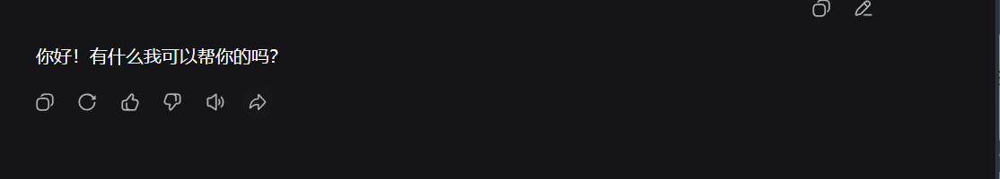

# DeepSeek 朗读解锁（浏览器插件）

> Unlock the official **Read aloud (TTS)** button on `chat.deepseek.com` for accounts outside the grey release.
> Chrome / Edge **/ Firefox** MV3 extension · only flips a local client-side flag · talks to the official API with your own account.
>
> 🎬 演示视频（B 站）：https://www.bilibili.com/video/BV1bxYo6tELF/
>
> 📱 安卓 App 同样解锁：https://github.com/Eyeing0721/deepseek-apk-tts-unlock
>
> 📦 **下载**：[Releases](https://github.com/Eyeing0721/deepseek-tts-unlocker/releases/latest) —— Chrome/Edge 拿 `-chrome.zip`，Firefox 拿 `-firefox.xpi`
>
> 🇷🇺 **Русский интерфейс**: в попапе расширения выберите «Русский» в поле «Язык интерфейса». Рядом выбирается «Язык озвучки» — он влияет на названия голосов и официальные примеры; само чтение идёт на языке ответа. Экспорт диалога: MP3/WAV, отдельные голоса для DeepSeek и ваших сообщений. Есть опция «SRT-субтитры» — для сборки видео локально через ffmpeg; текст диалога никуда не отправляется.

让**没有被灰度到「朗读 / TTS」的 DeepSeek 网页版账号**也能用上官方朗读功能。


原理一句话：官方判断「要不要显示朗读按钮」只读本地缓存的远程配置
`localStorage["__ds_remote_feature_store_model"].entries.model_configs.value[].tts_feature`，
而服务端接口本身对普通登录账号是放行的（实测：未灰度账号同样能取 TTS 票据、拿到 4 个音色、
成功合成音频）。插件在页面脚本之前注入，只在**读取**配置时把 `tts_feature` 补成真值，
并把 `remoteVersion` 在内存里 +1 挡住服务端覆盖；官方播放器、音色、断线续传全部照常走官方实现。



实测情况（2026-09-12，一个确实没被灰度到的账号，服务端真值 `remoteVersion=81`、三个模型 `tts_feature=false`）：

- **接口侧**：`GET /api/v0/chat/tts/voices` 与 `POST /api/v0/auth/ticket {"scope":"tts"}` 都返回 `biz_code=0`；
  直连 `wss://chat.deepseek.com/api/v0/chat/tts/` 成功合成音频（`format=pcm` 24kHz 单声道、`format=opus` 均可）。
  也就是说服务端对普通登录账号是放行的，灰度只体现在前端那个开关上。
- **前端侧**：装好插件、刷新页面后，回答下方出现喇叭入口（见上图，比原来多出来的那一个就是「朗读」）。

> 关于磁盘：补丁本身只在内存里生效，但官方前端有时会把读到的那份配置回写进 localStorage
> （例如 81 变成 1081）。插件的 `setItem` 会把抬高的部分减回去，所以磁盘通常仍是官方原值；万一被回写，**卸载插件后按钮可能留到官方下次下发新版本号**。
> 想立刻恢复原样，点插件里的「清掉本地缓存并刷新（还原）」或书签②即可。


---

## 一、安装

先打包（可选，仓库里已经带了成品）：

```powershell
pwsh -File build.ps1
# dist/deepseek-tts-unlocker-chrome.zip
# dist/deepseek-tts-unlocker-firefox.xpi
```

### Chrome / Edge（1 分钟）

1. 下载/拷贝整个 `deepseek-tts-unlocker` 文件夹到本机任意位置（解压后不要删）。
2. 打开扩展管理页：
   - Edge：地址栏输入 `edge://extensions`
   - Chrome：地址栏输入 `chrome://extensions`
3. 打开右下角（Chrome 是右上角）的 **开发者模式**。
4. 点 **加载已解压的扩展程序** → 选中 `deepseek-tts-unlocker` 这个文件夹（或 `dist/chrome`）。
5. 回到 `chat.deepseek.com`，**刷新一次页面**。

> 要求 Chrome / Edge 111 及以上（用到 MV3 的 `world: "MAIN"`）。现在的浏览器都满足。

每条 AI 回答下面就会出现「朗读」按钮，点它就能听；设置页里也会多出「朗读音色」。
点工具栏上的插件图标可以看状态和换音色。

### Firefox（要求 Firefox 140+）

Firefox 版本包在 `dist/deepseek-tts-unlocker-firefox.xpi`（一个 zip，只是扩展名不同）。
Firefox 的扩展要签名才能**永久**安装，所以有三种走法，挑一个：

**① 临时加载（最快，重启浏览器后失效 —— 适合先试试）**

1. 地址栏输入 `about:debugging#/runtime/this-firefox`
2. 点 **临时载入附加组件…**
3. 选 `dist/firefox/manifest.json`（解压 `dist/firefox/` 后选里面的 manifest.json 也行）
4. 回到 `chat.deepseek.com`，刷新一次

**② 装成正式扩展（长期用，需要 Firefox Developer Edition 或 Nightly）**

1. `about:config` → 搜 `xpinstall.signatures.required` → 改成 `false`
2. `about:addons` → 右上齿轮 → **从文件安装附加组件** → 选 `deepseek-tts-unlocker-firefox.xpi`

> 正式版 Firefox 会忽略上面那个开关（Mozilla 只在 Dev/Nightly/ESR 上允许关签名校验），
> 所以想在**正式版**里永久安装，走 ③。

**③ 上 AMO 自助签名（免费，签完正式版也能永久装）**

把 `dist/deepseek-tts-unlocker-firefox.xpi` 传到 [addons.mozilla.org/developers](https://addons.mozilla.org/developers/)
选「On your own」（self-distribution）走一遍自动签名，下载签名后的 xpi 安装即可。不上架也能签。

**Firefox 的一个坑**：Firefox 把「站点访问权限」当成可选权限，装完不一定自动给。
装好后点一下插件图标，如果显示 **「还差一步：允许本扩展访问 chat.deepseek.com」**，
点那个授权按钮即可（或者去 `about:addons` → 本扩展 → 权限 → 允许站点访问）。

> 实测（Firefox Developer Edition 156，headless，geckodriver 0.36）：
> 在真实的 `chat.deepseek.com` 上，主世界注入 ✓、读配置补 `tts_feature` ✓、
> 版本号 81→1081 抬高 ✓、写盘时减回去 ✓（4/4 通过）。
> `web-ext lint` 也是 0 error。

## 二、不装插件也行：书签版（零安装，任何浏览器）

把下面两段分别拖到书签栏（或新建书签、把地址粘进去）：

**① 开启朗读**（在 `chat.deepseek.com` 页面点一下）

```text
javascript:(()=>{const k='__ds_remote_feature_store_model';const r=localStorage.getItem(k);if(!r)return alert('没找到配置缓存：先登录并刷新一次页面');try{const s=JSON.parse(r);const l=s.entries.model_configs.value;if(!Array.isArray(l))return alert('配置结构变了，插件版更稳');l.forEach(c=>{if(c)c.tts_feature={}});s.remoteVersion=Math.max(s.remoteVersion||0,1e9);localStorage.setItem(k,JSON.stringify(s));location.reload();}catch(e){alert('失败：'+e);}})();
```

**② 还原**

```text
javascript:(()=>{localStorage.removeItem('__ds_remote_feature_store_model');location.reload();})();
```

书签版的代价：它把版本号顶到很大，会**冻结远程配置更新**（官方新模型/新功能可能不下发），
想恢复就点②。插件版没有这个副作用（磁盘上永远保留官方原值）。

> 提示：Chrome/Edge 首次粘贴 `javascript:` 开头的书签可能会自动去掉 `javascript:`，
> 手打一遍前缀即可；或者先在任意页面搜索一下"bookmarklet"，把地址改回去。

## 三、插件做了什么

| 文件 | 作用 |
|---|---|
| `inject.js` | 主世界、`document_start` 注入，包一层 `Storage.prototype.getItem`：读到配置缓存时给每个模型补 `tts_feature`，并把 `remoteVersion` 在内存里抬高 1000 挡住服务端覆盖；`setItem` 里再减回去，磁盘保持官方原值。另外顺手截获官方前端自己请求的 `history_messages`，给下载列表做兜底。**Chrome 和 Firefox 共用同一份。** |
| `bridge.js` | 隔离世界脚本，读同源 `localStorage.userToken`，代弹窗调用 `/api/v0/chat/tts/voices`、`/api/v0/chat/tts/voice`、`/api/v0/auth/ticket`、`/api/v0/chat/history_messages`；导出的任务（逐条合成、MP3/WAV 编码、保存文件）都在这里跑，弹窗关掉也不中断。 |
| `popup.html/js` | 状态面板：注入是否生效、账号本来有没有被灰度到、切换朗读音色、选择界面语言与朗读语言（含官方试听）、下载 MP3/WAV、按「DeepSeek / 你」分配音色、整段对话合成（含进度与取消）。Firefox 下还会检查站点权限并提供一键授权。 |
| `i18n.js` | 弹窗文案表（中文 / English / Русский）与音色名称、描述的兜底翻译。加一门界面语言只需在这里加一项。 |
| `lamejs.min.js` | 内置 MP3 编码器（lamejs 1.2.1，LGPL-3.0，未修改，可独立替换），作为 content script 注入。许可证见 `LICENSE-lamejs.txt`。 |
| `_locales/` | 清单本地化（`zh_CN` / `en` / `ru`，默认 `en`），让浏览器工具栏和商店里的扩展名称、描述跟随浏览器语言。 |
| `manifest.json` | Chrome / Edge 的清单（MV3）。 |
| `manifest.firefox.json` | Firefox 的清单（MV3 + `browser_specific_settings`），比 Chrome 版多一个 `optional_host_permissions` 用于运行时授权。 |
| `build.ps1` | 一份源码 → `dist/` 下 Chrome zip 与 Firefox xpi。 |

跨浏览器用到同一条 MV3 能力：`content_scripts[].world = "MAIN"`（Chrome 111+ / Firefox 128+，Firefox 包声明的是 140+）。
脚本里所有扩展 API 都走 `browser.* ?? chrome.*` 的兼容写法。

### 界面语言 / 朗读语言

弹窗顶部有两个下拉框，选择会存在扩展自己的 `localStorage` 里，下次打开继续生效：

- **界面语言**：中文 / English / Русский。首次打开按浏览器界面语言自动选择，之后记住手动选择。
- **朗读语言**：决定音色名称、描述和「试听」按钮用哪种语言，并标注当前音色是否支持该语言
  （不支持时选项后面会有 ⚠）。可选语言来自官方 `/tts/voices` 返回的 `languages` / `demo_urls`。
  注意：**实际朗读的语言由回答原文决定**，插件无法让服务端把中文回答改用俄语朗读；
  这个选项帮你挑一个支持目标语言的音色，并能直接听该语言的官方样例。

### 下载音频（MP3 / WAV，按角色配音）

弹窗里的「下载音频」区块会从 `/api/v0/chat/history_messages` 读取当前会话最近 400 条消息。
读取时兼容当前接口的 `fragments[].content`（正文在 fragment 里，消息级 `content` 是老格式），
并带 `cache_version=0` 强制拿全量快照，避免服务端返回 `MERGE` 增量（0 条）。
如果插件直连接口没拿到消息（比如官方接口参数变了），会自动改用**官方前端自己请求的那份历史**
（`inject.js` 在主世界截获 `fetch` / XHR 的响应），所以只要页面上能看到对话，列表通常就能出来。
合成走官方同款流程：`POST /api/v0/auth/ticket {scope:"tts"}` 取一次性票 →
`wss://chat.deepseek.com/api/v0/chat/tts/?...&format=pcm` 收 24 kHz 单声道 s16le 帧。
如果连接中途断开，会按官方协议用 `audio_id` + `received_seq` 续传（最多重试两次），
所以长回复不会因为一次掉线就少一截；确实拿不回来时，只保留已收到的音频，
字幕也只覆盖有声音的部分（不会把整段文字压进剩下的时长）。

**格式**：下拉框可选 **MP3**（内置 `lamejs`，128 kbps）或 **WAV**（24 kHz / 16 bit 无损）。
浏览器扩展运行在沙箱里，无法调用系统安装的 `ffmpeg`，所以这里直接内置了 MP3 编码器，
不需要任何外部程序。

**长对话**：导出在页面的 content-script 里执行，不在弹窗里：

- 弹窗可以关掉，任务会继续跑，文件自己保存；
- 进度显示「正在合成 N/M…」，旁边有「取消」按钮（已合成的部分仍会保存）；
- MP3 按条即时编码，内存占用不随对话长度增长；
- 消息列表取全部（最多最近 400 条），不再是 20 条；
- 遇到额度用尽（错误码 4）会停下，已合成的部分照常保存。

**不分段** 时，所有消息的音频按顺序拼成**一个**文件（导出时就已合成好，不需要事后再合并）。

**分段导出**：下拉框可选「不分段 / 每 5 / 10 / 20 分钟」。分段按目标时长在**采样级别**切分，
所以即使是单条超长回复（例如一次 32 分钟的朗读）也会切成多段；每段单独生成
`…-part01.mp3`、`…-part02.mp3`，勾选字幕时每段也各自带一个 `.srt`
（时间轴从该段开头重新计时，文本按时间比例分配到各段）。
第一段之外的下载可能需要浏览器允许「下载多个文件」。

**两种音色**：区块里有两个音色下拉框——「DeepSeek」和「你」。
单条下载会按消息角色自动选对应音色；勾选「整个对话」则把所有消息依次合成（首尾相接）。
切换音色用 `POST /api/v0/chat/tts/voice`，结束后会把账号原来的音色恢复；
如果导出途中页面被关掉，下次加载页面也会恢复。整个对话会消耗较多朗读额度。

### 视频与字幕

勾选 **「同时导出 SRT 字幕（可做视频）」** 后，音频旁边会多一个 `.srt` 文件：
时间轴按每条消息实际合成的时长计算，长句会切成适合单屏阅读的短行。
导出完成后按钮区会出现 **「ffmpeg 命令」**：点击即可把现成命令复制到剪贴板
（多段时是合并成一条 MP3 的命令，单段带字幕时是合成视频的命令），
在下载目录打开终端粘贴执行即可。扩展本身不能启动 ffmpeg（浏览器沙箱限制），
所以这里只提供命令，视频由本机 ffmpeg 完成。手动写的话，Windows 示例：

```bat
ffmpeg -f lavfi -i color=c=0x111111:s=1280x720:r=30 ^
       -i deepseek-dialog-20261102-171333.mp3 ^
       -vf "subtitles=deepseek-dialog-20261102-171333.srt:force_style='FontName=DejaVu Sans,FontSize=28'" ^
       -c:v libx264 -pix_fmt yuv420p -c:a aac -shortest out.mp4
```

**关于第三方网站**（online-video-cutter 之类）：插件**不会**把对话正文发出去，
既不会自动上传，也不会因为「两边都用同一个 Gmail 登录」就发。
同一个 Google 账号登录不等于同一个信任边界——那是另一家公司、另一套数据条款，
和 DeepSeek 的对话数据没有关系。所以插件只做本地导出（音频 + `.srt`），
要不要再上传到别处由你自己决定。

> 更新插件后记得**刷新一次 DeepSeek 标签页**：已打开的页面里仍然跑着旧的 content script，
> 弹窗会显示「需要刷新页面」并给出刷新按钮（`bridge.js` 通过 `bridgeVersion` 自检版本）。

权限仍然只有一个：`https://chat.deepseek.com/*`。不收集数据、不向第三方发送任何东西；
「试听」会直接用 `<audio>` 播放官方 CDN 上的公开样例（`cdn.deepseek.com`，不需要 token）。

## 四、卸载 / 还原

- 卸载：扩展管理页里「移除」，或关掉开发者模式。
- **卸载前建议先点一次插件里的「清掉本地缓存并刷新（还原）」**，把前端可能回写的那份补丁配置清掉；
  不点也行，官方下次下发新配置版本号时会自动恢复。
- 书签版还原：点书签②。

## 五、已知边界

- 「朗读」读的是**会话里已有的消息**：请求只带 `chat_session_id + message_id`，正文由服务端取。
  所以入口是每条回答下的小喇叭，不能让它读任意一段你自己粘的文本。
- 网页端只有「朗读」，没有 App 的语音对话（协议里 `mode` 恒为 `manual`）。
- 音色语言表不同：贝壳/白浪支持 29 种语言，海星/暗潮只支持中英日韩等 10 种；
  撞语言不支持时会提示「当前语言暂不支持朗读，可尝试切换音色」。
- `ticket` 是一次性的、600 秒有效；官方前端每轮连接都重新取票，插件不碰这部分。
- 「下载音频」和官方朗读走同一个 TTS 接口，同样消耗朗读额度、受频率限制；
  额度用完 / 频率过高 / 音色不支持该语言时，弹窗里会直接给出对应提示。
- 「整个对话」是逐条请求：N 条消息会合成 N 次，耗时和额度消耗都按条累加；
  单条超长回答受服务端 TTS 单次时长限制，必要时会在结果里显示为跳过。
- 这是灰测功能的接口，官方随时可能改协议或加服务端校验；届时插件可能需要更新。

## 六、音色对照（实测）

| voice_id | 中文名 | 性别 | 描述 | 语言 |
|---|---|---|---|---|
| `mira` | 贝壳 | 女 | 百变活泼（默认） | 29 种 |
| `echo` | 白浪 | 男 | 明朗坚定 | 29 种 |
| `stella` | 海星 | 女 | 俏皮甜美 | 10 种 |
| `tide` | 暗潮 | 男 | 低沉浑厚 | 10 种 |

官方音色试听（公开 CDN，不登录也能听）：
`https://cdn.deepseek.com/chat/tts/voice-demos/mira_zh.79e34098.mp3`
（把 `mira` 换成 `echo` / `stella` / `tide`，`zh` 换成别的语言码）

## 七、免责声明

- 本项目只修改**浏览器本地**的功能开关，通过官方接口、用**你本人账号**的凭据请求；不绕过鉴权、不抓取他人数据、不代理他人流量。
- 「朗读」是官方灰度中的功能，接口和前端随时可能变更，本项目**不保证长期有效**，也不保证不被官方判定为非常规使用。
- 插件会把你的 `userToken` 留在页面上下文里用于调用官方接口（本来就在那儿），除此之外**不向外发送任何数据**。担心的话请自行审代码（自有代码 7 个源文件、约 1900 行；试听会直接请求官方 CDN 的公开样例）。
- 内置的 MP3 编码器 `lamejs.min.js` 是第三方 LGPL-3.0 库（lamejs 1.2.1，未修改，可独立替换），完整许可证见 `LICENSE-lamejs.txt`。
- 使用产生的一切后果由使用者自行承担。若官方发布正式版或明确禁止，请停用本项目。

## 八、相关

- `tools/console-probe.js`：控制台版探针 + 逆向出的完整协议备忘（票据、WebSocket 帧格式、错误码、音色字段），
  想自己写脚本或排查问题时看它。


